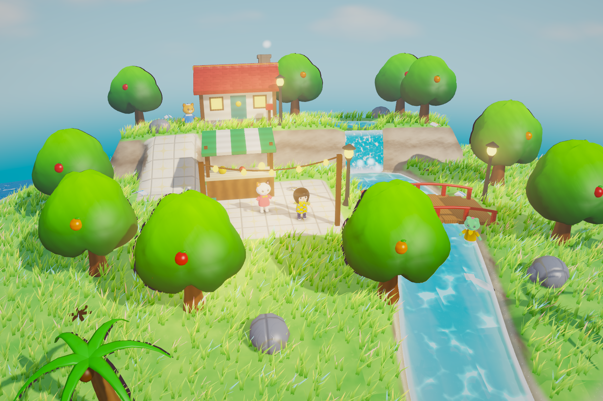
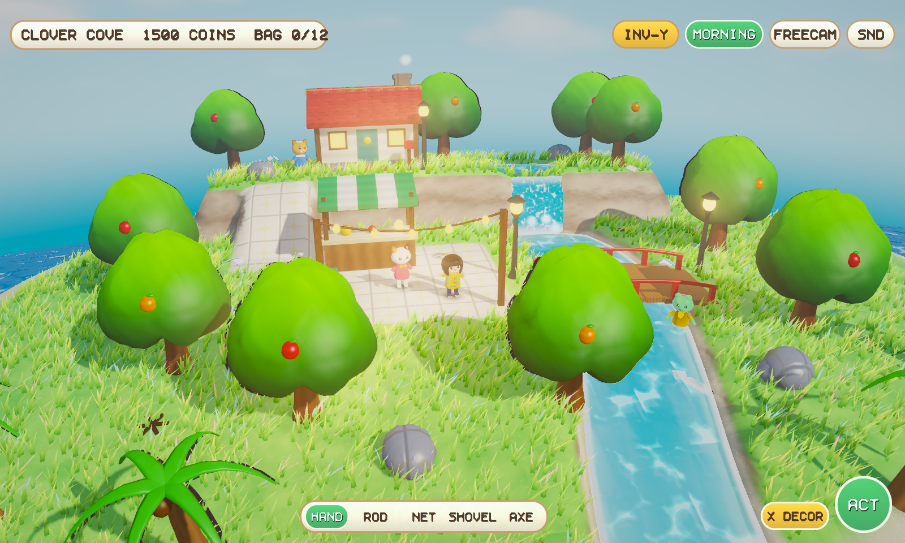
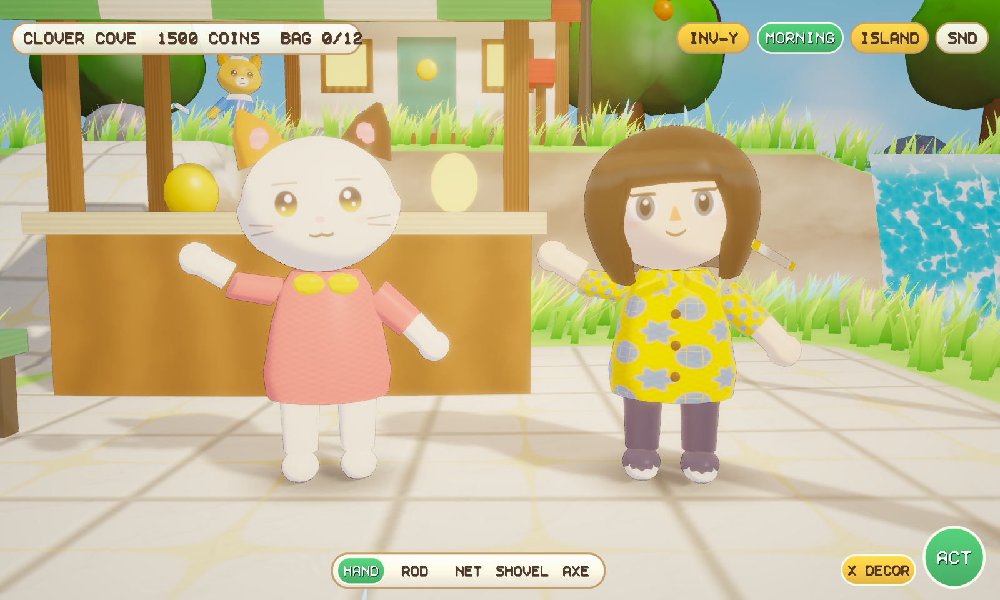
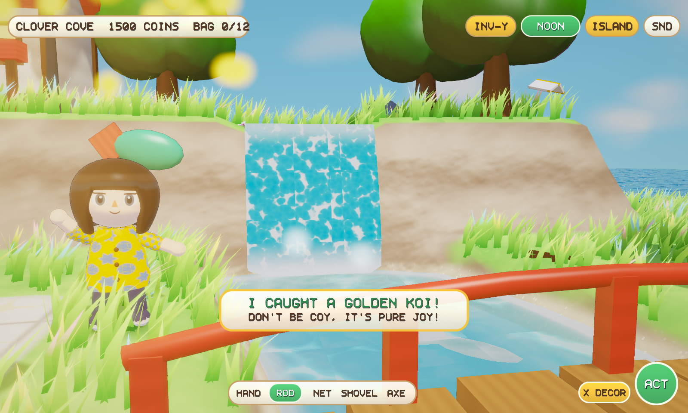
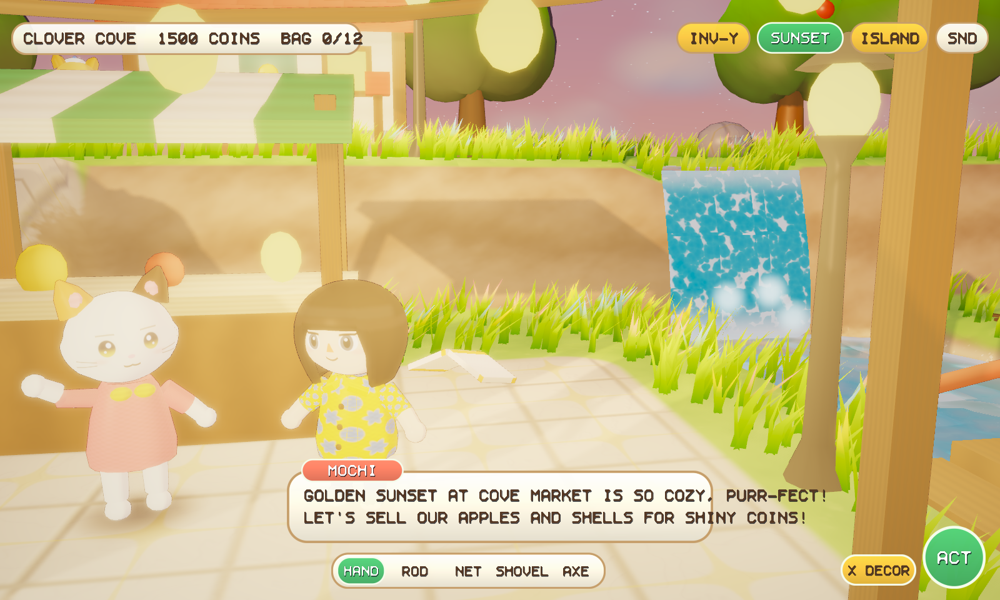
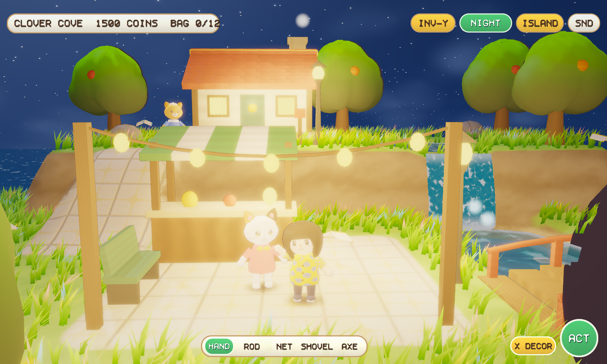

# Clover Cove (96 KB Edition)



**Clover Cove** is a cozy 3D island life game built from scratch in **zero-dependency C17** (with thin Objective-C Metal and Android NDK platform layers) where the **entire signed mobile package — code, 3D world, characters, animations, shaders, UI, music, and sound effects — fits inside ~72 KiB** (well under the strict `96 KiB` / `98,304`-byte demoscene limit).

There are **no external textures, no `.obj`/`.gltf` models, no `.wav`/`.ogg` audio files, no font files, no third-party libraries, and zero Java/Kotlin DEX bytecode**. Everything is synthesized procedurally in milliseconds at boot.

---

## Play the Demo

| Platform | Package Size | Download / Launch |
| :--- | :--- | :--- |
| **iOS / iPadOS** *(App Clip via TestFlight)* | **74.29 KiB** (`76,072 B`) | [**Join on TestFlight**](https://testflight.apple.com/join/N3MwbCd1) *(tap **Play** on the Clover Cove App Clip)* |
| **Android 8.0+** *(arm64-v8a Instant APK)* | **72.21 KiB** (`73,945 B`) | [**Download `CloverCoveInstant.apk`**](https://github.com/jsflax/clover-cove/releases/latest/download/CloverCoveInstant.apk) |
| **macOS 13+** *(Apple Silicon / Intel Metal)* | Desktop `.app` | [**Download `CloverCoveMac.zip`**](https://github.com/jsflax/clover-cove/releases/latest/download/CloverCoveMac.zip) |

---

## Screenshots

| Morning Cove & Rolling Horizon | Miniature Tilt-Shift Bokeh & SDF Faces |
| :---: | :---: |
|  |  |
| **Depth-Buffer Waterfall & Fishing** | **Cove Market Plaza & Villager Chat** |
|  |  |

<p align="center">
  
</p>

---

## What's Inside `< 96 KiB`?

### 1. Cozy Island Sandbox (`src/clover_cove/`)
- **5 Tools & Full Pocket Inventory**:
  - **Hand**: Shake fruit trees, harvest pears/peaches/apples/oranges, pluck coastal shells, chat with island neighbors (*Mochi*, *Puddles*, *Biscuit*), and sell your haul for **Coins** at **Cove Market**.
  - **Rod**: Cast a bobber into the river or ocean, wait for nibbles and the sink-splash bite, and reel in Sea Bass, Koi, Red Snapper, or rare Golden Trout.
  - **Net**: Sneak up on fluttering Monarch, Morpho, and Birdwing butterflies.
  - **Shovel**: Dig up star-marked fossils or strike **Treasure Rocks** for cascading Coin combos.
  - **Axe**: Chop fruit & coconut trees to shake down harvests or strike boulders.
- **Placeable Island Decor**: Drop glowing **Garden Lanterns**, crackling **Campfires**, and **Picnic Benches** anywhere on the island (`C` / **X DECOR** button / Gamepad `X`) — each dynamically contributing real-time warm point lighting.
- **Dynamic Time-of-Day**: Cycle seamlessly through **Morning**, **Noon**, **Golden Sunset**, and **Starry Night** (`T` / top-right time pill / Gamepad `Menu` or `D-Pad Up`).

### 2. Dual-Backend Stylized 3D Engine (`src/engine96k/`, `src/platform_*/`)
- **Identical Visual Pipeline on Apple Metal & Android OpenGL ES 3.0**:
  - **Shadows**: `2048x2048` directional sun shadow map with 8-tap Interleaved Gradient Noise (IGN) Vogel-disk soft PCF.
  - **Geometry & Instancing**: Unified 48-byte vertex format supporting both rigid props and 16-bone dual-weight GPU skinning, 5,400 hardware-instanced wind-swaying grass & wildflower blades, and rolling-horizon world curvature.
  - **Procedural GPU Materials**: 3 mipmapped `512x512` PBR detail textures rendered on the GPU in `< 1 ms` at startup, paired with infinite-resolution analytic SDF villager eyes/expressions, scalloped roof shingles, cobblestone curbs, and sparkling wet shoreline sand.
  - **Water & Post-Processing**: Depth-buffer Beer-Lambert water absorption, animated dual-layer Voronoi caustics, shore surf, interactive ring ripples, symmetric depth-crease SSAO, tilt-shift miniature bokeh DoF, volumetric sun god-rays, a 3-mip Karis Dual-Kawase HDR bloom pyramid, and AgX tonemapping.
  - **Zero-Font Vector UI**: Crisp analytic rounded-rectangle panels and 30-bit `5x6` stroke-bridged SDF glyphs packed into single `uint32_t` masks.

### 3. Real-Time 48 kHz Stereo Synthesizer (`clover_audio.c`)
- Lock-free procedural audio callback (`AVAudioSourceNode` on macOS/iOS, low-latency `AAudio` on Android):
  - Plucked acoustic guitar + warm Rhodes-style chord progressions that adapt tempo and voicing to the time of day.
  - Continuous filtered-noise ocean surf & breeze, terrain-aware footsteps, water splashes, coin chimes, catch fanfares, and pitched formant-filtered villager speech.

---

## Controls

| Action | Touch (iOS / Android) | Keyboard & Mouse (macOS) | Gamepad (Xbox / DualSense / MFi) |
| :--- | :--- | :--- | :--- |
| **Walk / Run** | Left Virtual Thumbstick *(outer ring runs)* | `W A S D` *(hold `Shift` to run)* | Left Stick *(hold `B` to run)* |
| **Use Tool / Interact / Talk** | **ACT** Button or Tap Target | `Space` / `Return` / Left-Click | `A` *(South)* |
| **Place Cozy Decor** | **X DECOR** Button | `C` | `X` *(West)* |
| **Switch Tool** | Tap Bottom Tool Dock | `1`–`5` | `LB` / `RB` or `D-Pad Left/Right` |
| **Cycle Time of Day** | **MORNING / NOON / SUNSET / NIGHT** Pill | `T` | `Menu` / `D-Pad Up` |
| **Orbit / Zoom Camera** | Two-Finger Drag / Pinch | Right-Drag / Scroll / `I J K L` | Right Stick / `LT` & `RT` |
| **Toggle 6-DOF Free-Cam** | **FREECAM** Pill *(top-right)* | `F` | `Y` *(North)* / `View` |
| **Toggle Camera Invert-Y** | **INV-Y** Pill *(top-right)* | `V` | `R3` *(Right Stick Click)* |
| **Mute / Reset Island** | **SND** Pill *(top-right)* | `M` *(mute)* / `R` *(reset)* | — |

---

## Building from Source

### Prerequisites
- **macOS Desktop**: macOS 13+ with Xcode Command Line Tools (`xcode-select --install`).
- **iOS App Clip & Simulator** *(optional)*: Full Xcode 15+ with the iOS SDK installed.
- **Android Instant APK** *(optional)*: Android SDK (`build-tools`, `platforms`, and `ndk`) at `$ANDROID_HOME` (or `~/Library/Android/sdk`) plus `keytool` (JDK).

### Build Commands
```bash
# Build macOS desktop app only -> dist/CloverCoveMac.app
./build.sh mac
open dist/CloverCoveMac.app

# Build all available targets (macOS + iOS App Clip IPA + iOS Sim + Android Instant APK)
# and verify mobile packages are strictly <= 98,304 bytes (96.00 KiB):
./build.sh
```

### Headless Screenshot Capture (macOS)
```bash
./build/CloverCoveMac --capture docs/screenshots
./build/CloverCoveMac --capture-card docs/screenshots/CloverCove_Card_1800x1200.png 0
```

---

## Project Layout

```text
src/
├── clover_cove/       # Procedural island meshes, 16-bone rig, 48 kHz synth, gameplay & UI
├── engine96k/         # Math, procedural mesh builder, vector SDF UI & Metal/GLES3 shaders
├── platform_apple/    # Metal RHI, macOS Cocoa/IOHID host & iOS UIKit App Clip host
└── platform_android/  # OpenGL ES 3.0 RHI & zero-DEX NativeActivity + AAudio host
```

## License

Released under the [MIT License](LICENSE).
